[clusterer_controller](../README.md) / Wire protocol

# Wire protocol

## Control plane at a glance

Encrypted UDP on the cluster's multicast group. Only a small cleartext header is visible on the wire - magic, cluster id, cluster identity and nonce - and it is the AEAD's associated data; everything else is sealed with **XChaCha20-Poly1305**, keys derived with **Argon2id**, the join handshake **Noise_NNpsk0**.

```text
[magic 2B][cluster_id 2B][cluster uuid 16B][nonce 24B] [type 1B][seq 4B][incarnation 8B][payload] [tag 16B]
 '---------------- cleartext, AAD ----------------'      '------------- encrypted ------------------'
```

The first magic byte is the wire version (`0xCB` + version, now **2**); the second selects the key tier:

| Tier | Magic | Key | Packets |
|------|-------|-----|---------|
| **bootstrap** | `0xCD01` | Argon2id(password) | `JOIN_REQ`, `KEY_GRANT`, `ACK`, `JOIN_REJECT`, `MASTER_BEACON` |
| **session** | `0xCD00` | per-cluster session key | `MASTER_ALIVE`, `ALIVE`, `NODE_ASSIGN`, `MEMBER_LIST`, `RESYNC`, `GOODBYE`, `KEY_HANDOFF`, `MASTER_PROBE`, `MASTER_PROBE_ACK`, `MAINT_SET` |
| **consumer** | `0xCD02` | per-cluster session key | messaging API traffic, rate-limited on its own budget |

Within one wire version, fields are only ever appended and read behind a length check, and a build drops a packet type it does not know; what a node's build implements is advertised as capability bits (see [Upgrading](deployment.md#upgrading)).

Legend for the diagrams below: **`-->>` unicast (1:1)**, **`-)` multicast (group)**.

## 1. Cluster formation (cold start)

Nodes start together, discover over multicast, and converge on the **highest-IP**
node as master with no split brain — lower-IP nodes *defer* self-promotion while
a higher-IP peer is still joining.

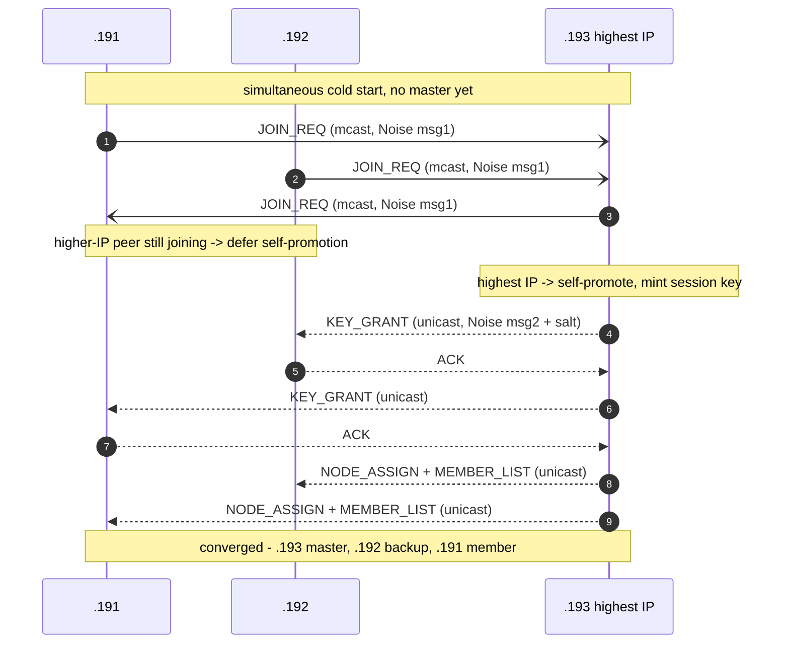

## 2. Member join into a running cluster

The join is **unicast to the joiner**: only the newcomer needs the full peer
list, so the master sends it 1:1 instead of multicasting N packets that every
member would decrypt and discard. Only the *newcomer's own* assignment is
multicast, so existing members learn it. A lost `KEY_GRANT` is recovered by
**ACK + retransmit** (§5), a lost snapshot by the `JOIN_REQ` retry.

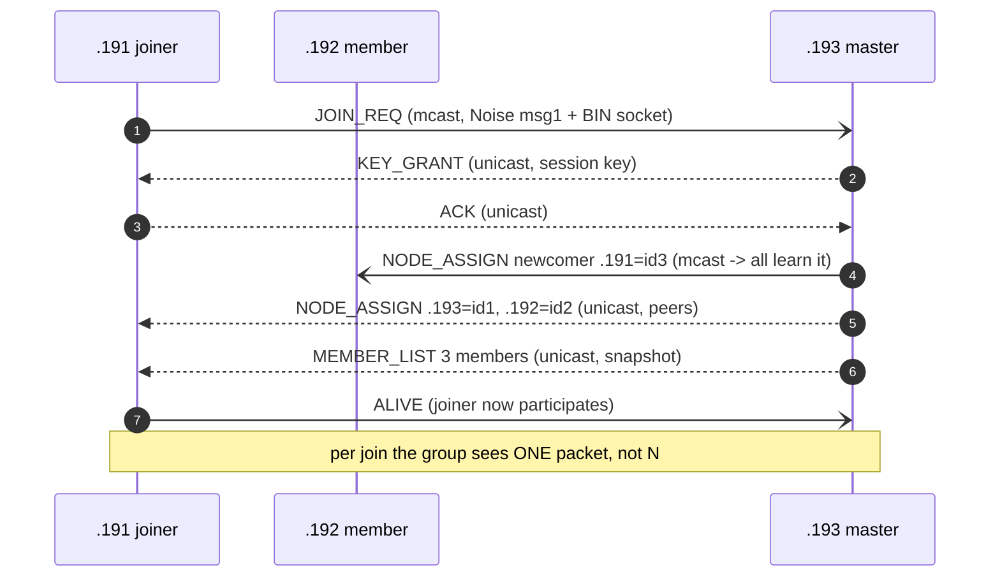

> Captured live on the test cluster (staged stop→rejoin of `.191`): JOIN_REQ →
> unicast KEY_GRANT + ACK → mcast NODE_ASSIGN announce → unicast NODE_ASSIGN×2 +
> MEMBER_LIST, all sub-second.

## 3. Steady-state liveness — master-mediated (O(N²) → O(N))

Previously every node multicast an `ALIVE` every `query_time` and every node ran
an election off every one — O(N²) packets and cluster-wide decrypts. Now a settled
member **unicasts its ALIVE to the master**; the master folds all peers' liveness
into a **per-node-id bitmap** on its `MASTER_ALIVE`, and members trust that bitmap
to keep their election windows populated. The same `MASTER_ALIVE` also carries the
master's term, the maintenance state of every node, the number of members it hears
and the capabilities every live member shares.

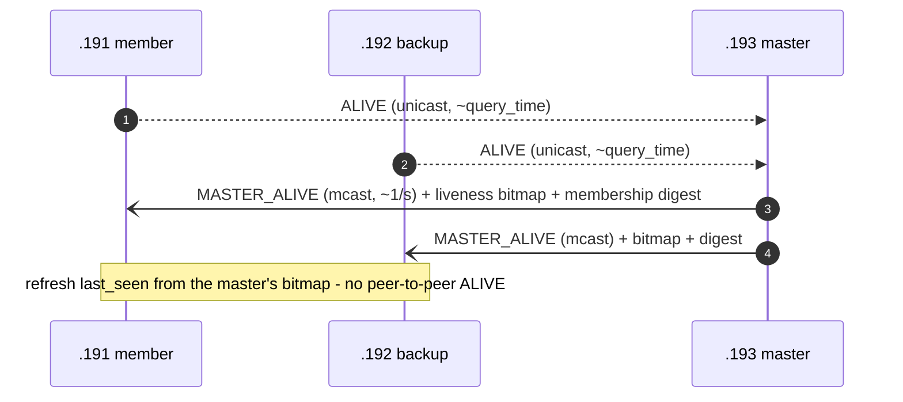

## 4. Anti-entropy — membership digest → RESYNC

Every `MASTER_ALIVE` carries a **digest** = active-peer count + order-independent
XOR of `FNV-1a(node_id, ip)`. A member whose computed digest differs has missed a
`NODE_ASSIGN` (whole peer, or just a node-id) and pulls a **rate-limited RESYNC**;
the master coalesces a burst into one re-broadcast. This is the multicast
counterpart to the 1:1 ACK path.

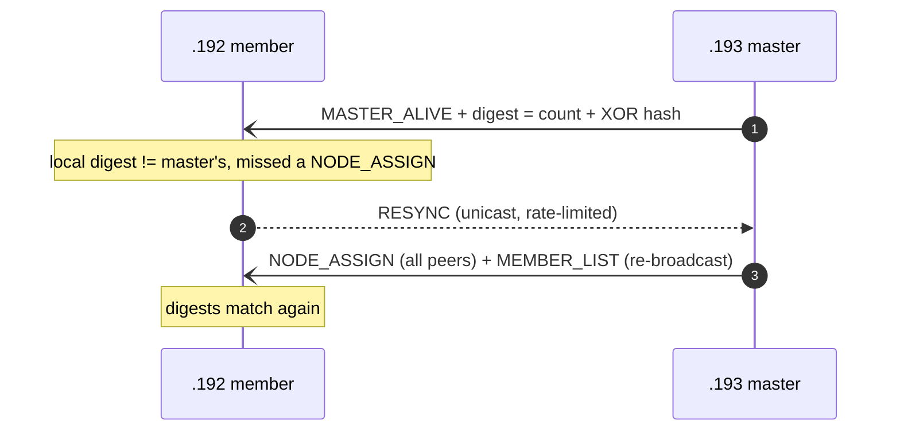

## 5. Reliable handshake — ACK + bounded retransmit

The 1:1 handshake rides unreliable UDP. A lost `KEY_GRANT` used to cost the joiner
its whole join window; now the master retransmits until ACKed (bounded), so a
single loss heals in **milliseconds**.

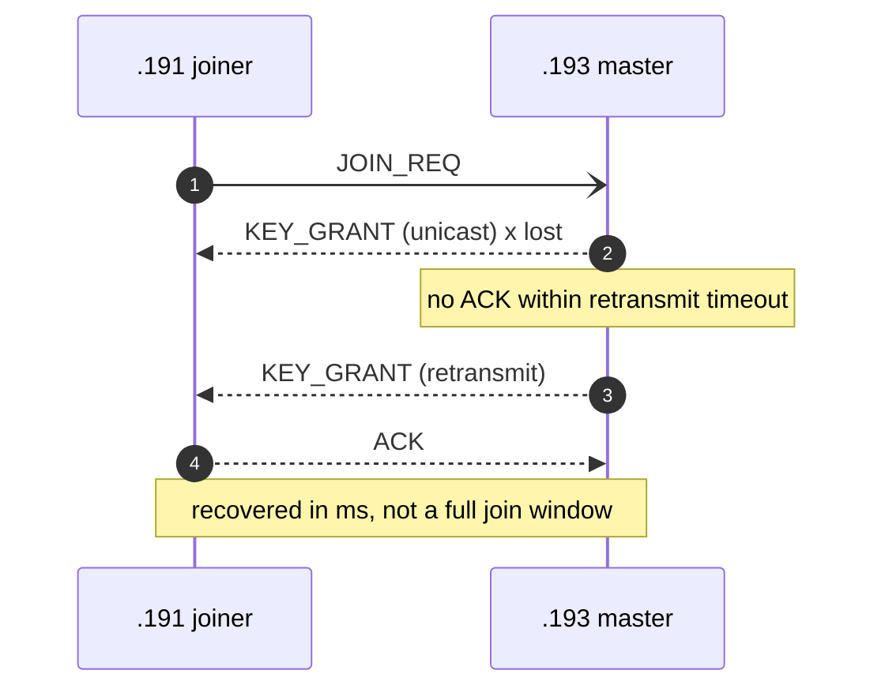

## 6. Graceful leave (GOODBYE)

A departing node multicasts `GOODBYE`. Survivors **re-elect locally** off the same
event — no MEMBER_LIST re-broadcast (that O(N), fragmenting packet was dropped from
the failover path); `MASTER_ALIVE` re-asserts and the digest reconciles stragglers.

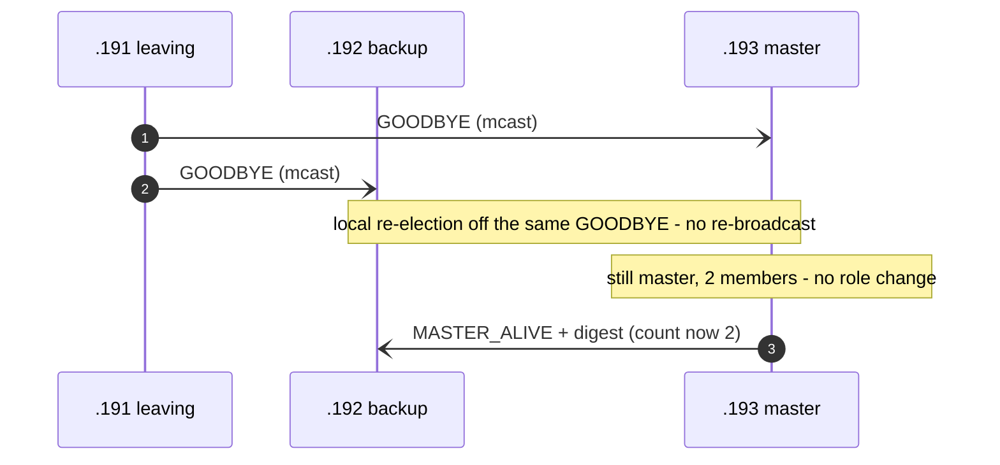

## 7. Master failover (crash)

The master goes silent. Each member's watchdog is **learned**, not fixed: the mean
and deviation of the gaps between `MASTER_ALIVE`s (3 s floor, 15 s cap). When it
fires, the member **asks the cluster** in one multicast `MASTER_PROBE` whether
anyone still hears the master: anyone who does makes it **hold** the election (a
fault between it and the master, not a dead master); **two peers confirming the
silence** (every peer, when there are fewer) let it elect at once; nobody answering means it may be the one cut off,
so it waits one more period. A confirmed election raises the term (**PreVote**);
an unconfirmed one keeps it. The new master takes the active sharing tag
**at once**.

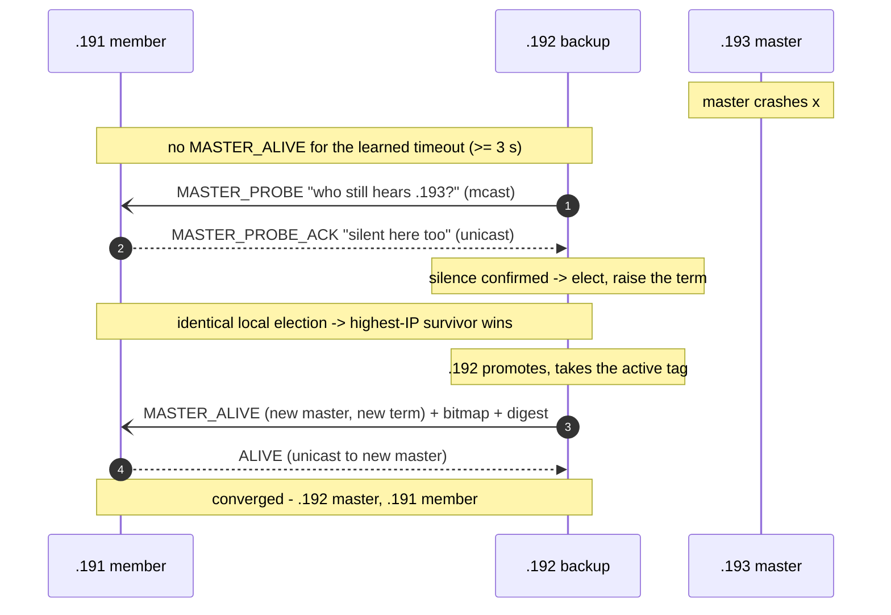

## 8. Graceful master handoff (KEY_HANDOFF)

On a *planned* master shutdown the outgoing master hands the session key to its
successor sealed to the successor's long-lived X25519 pubkey (`crypto_box_seal`,
learned from ALIVE) — so the successor takes over **without a rejoin**.

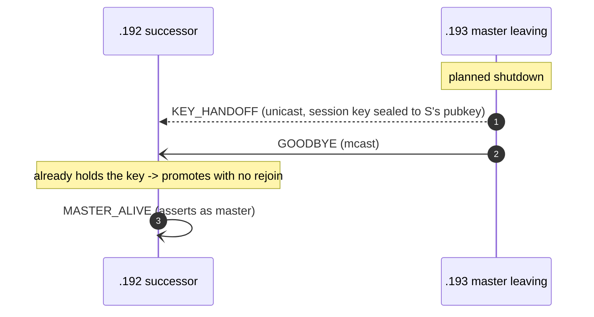

## 9. Wrong-password rejection

A node with the wrong password cannot produce a bootstrap-valid `JOIN_REQ`. After
repeated failures from one source the master emits an authenticated `JOIN_REJECT`;
independently, a genuinely-wrong-password joiner self-terminates after its defer
budget rather than forming a lone split-brain master.

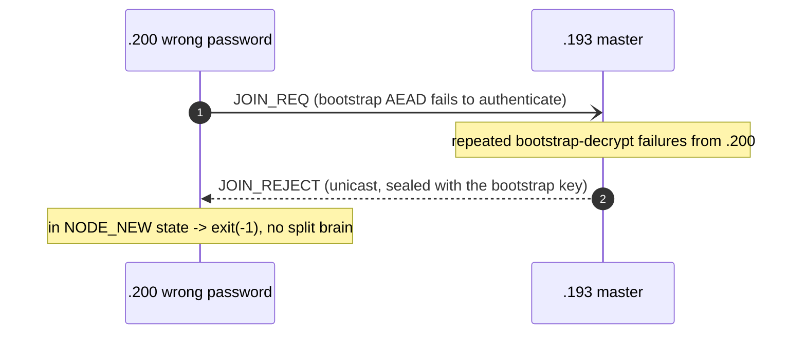

## 10. Split-brain merge (MASTER_BEACON)

If a partition heals and two masters exist, each periodically emits a
bootstrap-keyed `MASTER_BEACON` (readable across different session keys). Two
masters that share a key also hear each other's `MASTER_ALIVE`. **Both paths
rank by one ordering**, so the two ends always agree on who stands down - before
this, the keepalive path yielded to the higher IP while the beacon path ranked by
member count, and two masters could each yield to the other:

1. **members it hears** - the live count each master announces in its
   `MASTER_ALIVE` and beacon (table counts when the other side is an older
   build): the larger partition wins, disturbing the fewest nodes;
2. **term** - the newer mastership wins. A node raises the term only when its
   election was confirmed (peers confirmed the silence, the master said
   GOODBYE or handed over for maintenance), which is how a takeover beats the
   master it replaces;
3. **IP** - total tiebreak.

Members deliberately precede term: a node that is cut off still elects itself
eventually, and ranking on term first would hand the cluster (and its sharing
tags) to the least reliable node.

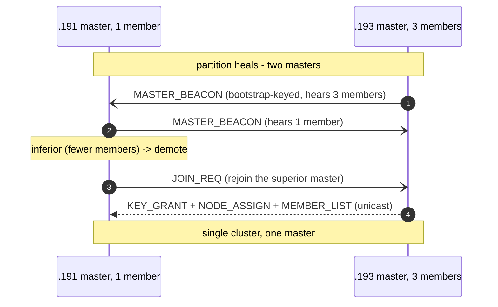

## 11. Shared-port unicast demux (multi-cluster on one node)

When several controller clusters on one node share a multicast *port* (distinct
groups), multicast reaches only the socket that joined the group - once
`IP_MULTICAST_ALL` is cleared, which Linux does not do by default - but unicast is
demultiplexed by port alone, so a 1:1 reply can land on the wrong sibling's socket. The receiver recovers it: on a
`cluster_id` mismatch it forwards the *still-encrypted* datagram to the correct
local cluster's worker via `ipc_send_rpc()`, which decrypts it with its own key.

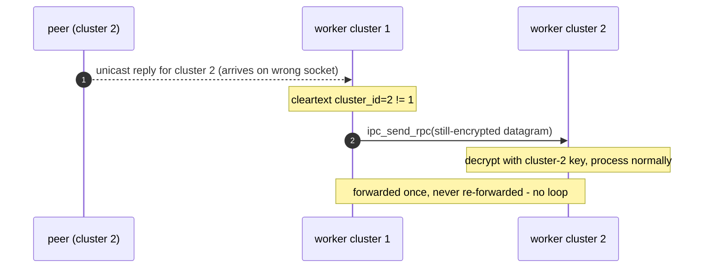

## 12. A restarted node is recognised by its first packet (incarnation)

Every packet carries the sender's *incarnation* (its start time), inside the AEAD.
Replay windows are kept per (sender, incarnation): a higher incarnation means the
peer restarted and numbers from 1 again, so its windows restart on that packet; a
lower one is a replay from a previous life and is refused. Before, a restarted
node's low sequence numbers were "older than the replay window" to every peer
until a `MEMBER_LIST` reset them (the 10-hour black hole fixed earlier by
announcing every join) - and that reset, done on every list, re-admitted one
replayed packet per peer. The master also carries the incarnation it admitted a
node at in `NODE_ASSIGN`, which covers a node whose clock stepped back across its
restart.

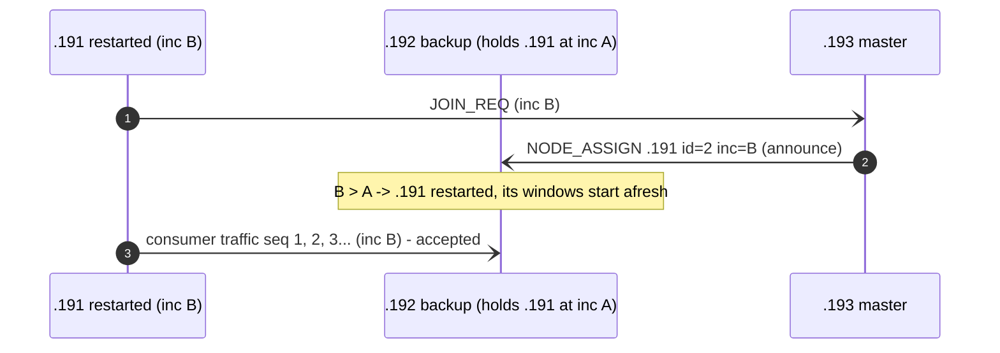

## 13. Partitions with different settings never merge - and nobody dies for trying

The beacon now carries the master's consistency-critical settings and MTU. A
master compares them with its own **before** ranking: if they differ (settings
under `on_config_mismatch=reject`, MTU always), neither master merges and both log
which values differ. Previously the inferior master merged, the superior one
refused its `JOIN_REQ`, and the merging node called `exit(-1)` - which takes down
the *correctly* configured nodes whenever the misconfigured side is the larger
partition. As a backstop, an established node refused during a merge no longer
exits: it re-elects within its own partition and ignores that master for 60 s.
A node that has not joined anything yet still shuts down on a refusal.

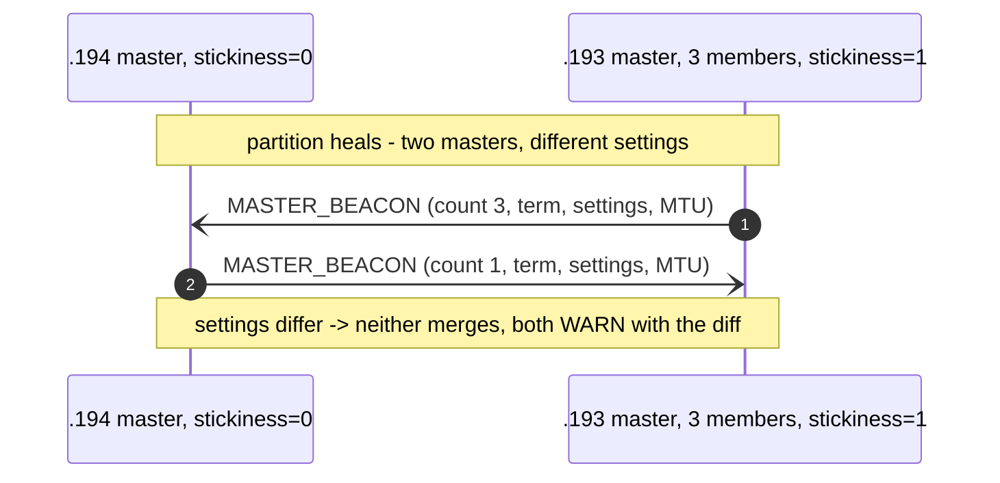

## 14. A founded cluster identity - two deployments never merge

`cluster_id` is a configured number, so a lab cloned from production onto the
same VLAN (same group, password and `cluster_id`) used to merge into production -
and with `manage_shtags`, could take its sharing tags. Now the node that founds a
cluster mints a 16-byte UUID v7; joiners adopt it from the master's `KEY_GRANT`;
every packet carries it in the AAD-bound cleartext header. It is *provisional* for
30 s (a simultaneous cold start with two founders still settles into one cluster),
then *established*: packets stamped with any other identity are refused before
decryption and logged once a minute. Packets with no identity (a joiner, every
`JOIN_REQ`) always pass, so new and restarted nodes join normally, and a partition
of one cluster still heals (both halves hold the same identity). Nothing persists:
a whole-cluster restart founds a new identity; `uuid=` in the `cluster` string pins
one (a UUID, or any name hashed into a v8 UUID) for fleets that want it stable.

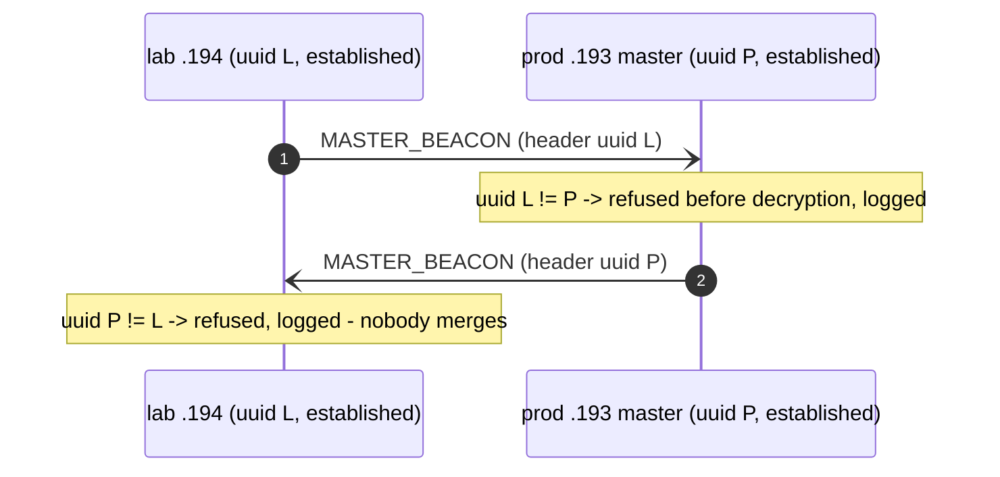

## Complexity

| Path | before | after |
|------|--------|-------|
| steady-state liveness | O(N²) packets + decrypts | **O(N)** (member→master unicast + one MASTER_ALIVE bitmap) |
| join into N-node cluster | O(N) group packets, O(N²) decrypts | **O(1)** group + O(N) unicast to the joiner only |
| failover | +O(N) MEMBER_LIST re-broadcast (fragments >~80 nodes) | local re-election, **no re-broadcast** |
| lost handshake packet | whole join window (~seconds) | ACK + retransmit (**ms**) |
| missed NODE_ASSIGN | silently incomplete BIN mesh | digest-driven **RESYNC** repair |
